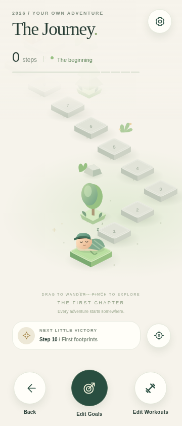
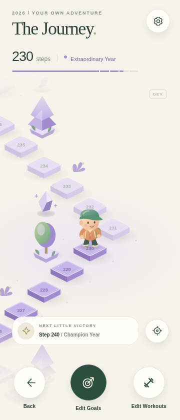
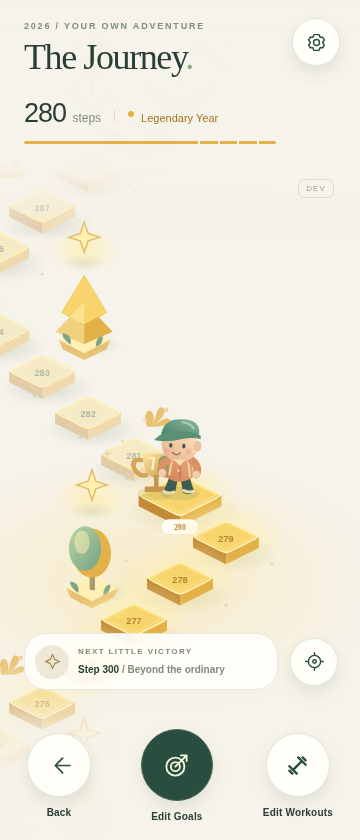

# Milestone 1 validation

## Numbered preview iteration 1: Android SVG rendering

- Published Android iteration **1** to `preview`: [update group 14bdb698](https://expo.dev/accounts/raysayantan07s-team/projects/the-journey/updates/14bdb698-5320-4e23-accd-250425c62e83), Android update ID `01a1abfe-f4b6-7a0b-b623-07dd215f74c9`. Publication confirmed the matching runtime. No new APK was built.

- Device feedback on the first OTA release reported worse map dragging and pinching. Inspection of the installed `react-native-svg` Android implementation confirmed that every animated SVG descendant invalidates and recycles its root's bitmap. A route-window-sized SVG made even character breathing expensive.
- Android now uses small independent terrain SVGs (340 × 180 world units), isolated mist/sparkle surfaces, and a separate 220 × 220 character surface. Pan/zoom transforms native views on the UI thread. Retained tile roots survive window shifts. A layout container covers the current route window, but it is not rasterized into one giant SVG bitmap. Camera origin and container layout change together; character placement uses the same global camera coordinates.
- The heading displays the bundled iteration. `scripts/update-preview.cjs` validates EAS configuration and increments `src/iteration.json` before publishing; failed publications restore the previous number. Release regression tests exercise success, failure, and retry without making network calls. Use this release command for subsequent numbered updates.
- Android preview fingerprint remains `58c8ef5b9e8676eec1ab0efa5f28ec870ebfec3e`. Native dependencies and installed APK are unchanged. Package scripts remain intact because their text is included in this SDK's fingerprint.
- Browser smoke checks can inspect either the standard web SVG or the layered scene. The layered scene was temporarily selected in the browser for verification, then restored to Android-only selection before publication. Checks cover character/terrain alignment, bounded SVG dimensions, retained tile roots across window boundaries, touch pan/pinch, recentering, milestone hit testing, panels, narrow layouts, and persistence. Browser correctness is not an Android frame-time measurement; actual Fold responsiveness still requires phone testing.

Validated in Codex Cloud using Node 24.22.1, npm 11.9.0 and system Chromium. Captures use a **360 × 840 logical-pixel** browser viewport. They are browser renders of actual SVG scene elements, not Android screenshots or assets used as map backgrounds.

## Passed

- `npm run check`: strict TypeScript, Expo ESLint and **6 executed tests**, all passing. Tests cover every tier boundary, deterministic prefix-stable/non-overlapping route windows through step 1000, reverse/forward character position interpolation, pause/ability priority, repeated focal camera math, and extendable milestones through step 1,000,020.
- `npm run format:check`: all supported source files formatted.
- `EXPO_OFFLINE=1 npx expo install --check`: dependencies match Expo SDK 58's bundled version metadata. The online Expo directory/compatibility API was blocked by the cloud network policy; this was not counted as an online check.
- `EXPO_OFFLINE=1 npx expo prebuild --platform android --no-install`: Android project and config plugins generated successfully. `expo-system-ui` resolves the initial light-appearance warning. Generated native files remain ignored; EAS can regenerate them from configuration.
- `EXPO_OFFLINE=1 npx expo export --platform android --output-dir dist/android`: the finished Android code compiled to a Hermes bundle, approximately 3.3 MB. **This is not an APK or a Gradle build.**
- `npm run smoke`, with a running Expo web development server: tier previews at 180, 205, 230, 250, 260, 261 and 280; nine manual character states; settings and all three destination buttons; three repeated touch pan/pinch cycles; camera recentering; real world-coordinate milestone tapping; panel camera preservation; minimum 48 px control bounds at 320/360/412 widths; sandbox restoration after reload. No browser runtime errors were recorded.

The initial pinch test ended too soon after the recognizer's activation threshold; the corrected test moves both touches farther and verifies a real scale change. The initial monument tap landed under the fixed next-reward HUD; the corrected test pans that monument into the unobstructed map before hit testing. Neither case was accepted as a passing interaction without diagnosis and rerun.

- `npm ci`: clean installation from the lockfile succeeded (769 packages).
- Production web export and browser check: opens at step 0 even when development sandbox storage contains 280; developer controls are absent and the world renders without browser runtime errors.

The final milestone panel enter/exit animation was checked after a cache-cleared development startup: opens and dismisses correctly, with no browser errors or warnings.

## Visual review

The initial composition spread too far across the narrow viewport. The refined route uses tighter centered switchbacks, rounded/beveled top faces, extruded side faces, radial cast shadows, softened ground lighting, distinct muted future stones, a more opaque HUD fade, and a readable floating reward chip. Reward artwork is offset from the explorer at milestones. Animated original character artwork includes breathing, locomotion, floating wings, tear/rest variants and a seated recovery pose.

| Fresh journey                                   | Violet region                                    | Legendary extension                                       |
| ----------------------------------------------- | ------------------------------------------------ | --------------------------------------------------------- |
|  |  |  |

## Still unverified

- A signed Android preview APK was produced by EAS build `dc97c00b-092a-4de5-8f53-4c1e0f21cbee`; native behavior and frame timing still require device testing.
- Native Android rendering, SQLite execution, hardware Back behavior, actual cutout/gesture safe areas, Samsung font/display scaling, gesture transitions and background/resume must be tested in the APK. Native project generation and Hermes compilation do not establish these behaviors on a device.
- No 60/120 fps claim: frame timing and battery/thermal behavior need actual Fold cover-screen profiling.
- Production has no real workout data source yet. SQLite persistence in this milestone is explicitly the isolated development preview, not the eventual workout schema.

### Camera responsiveness

- Native pan/zoom now transforms the SVG's containing view on the UI thread instead of changing the SVG group matrix on every gesture frame. Android can reuse the SVG bitmap while the camera moves.
- Decorative ambient animation pauses during active camera gestures and resumes from its current pose. Failed pinch recognition after a single-finger pan no longer starts a competing settle animation.
- The world canvas uses zoom bands and viewport-dependent overscan. At 840dp height it renders at most 51 tiles at minimum zoom, about 39 near normal zoom, and 27 near maximum zoom. Overlapping tile objects and keyed elements are retained; outgoing tiles are released, with no growing tile cache. Stone and garden artwork are memoized. Regression tests cover zoom-band boundaries, viewport coverage, bounded windows, retained object identity, and stable world coordinates across render-window changes.
- Validate on the Android preview device: repeatedly pinch in/out around an off-center landmark, drag between route windows, lift one finger during a pinch, tap rewards, and recenter. Check frame timing and memory on the device; browser correctness checks do not establish Android frame rate.

### Preview delivery for camera and windowing changes

- `npm run check`: TypeScript, lint, and all 10 tests pass.
- EAS Android fingerprint generated using the `preview` build profile matches the installed preview build `dc97c00b-092a-4de5-8f53-4c1e0f21cbee`: `58c8ef5b9e8676eec1ab0efa5f28ec870ebfec3e`.
- These changes use existing native modules and can be delivered as JavaScript through the `preview` EAS Update channel. Project `8356cd34-3b01-4c62-b64a-d1e879ed94a2` and Android package `com.thejourney.personal` are unchanged. No signing credentials are generated.
- Keep this work on `feat/fluid-camera-windowing` until device testing and user approval; do not merge into `main` yet.

### Preview update upload blocker

- Full browser smoke test passed: tier previews, nine animation states, repeated touch pan/pinch, recenter, reward taps, panel camera preservation, 320/360/412dp layouts, and persistence. The smoke test waits for the actual recenter result rather than a fixed animation delay.
- Latest Android Hermes export succeeded; TypeScript, lint, and all 10 tests passed.
- Source implementation was pushed as commit `39842dca23865e63754797cb62bee3afb6c524ce` on `feat/fluid-camera-windowing`.
- Android-only EAS Update publication to channel `preview` was attempted after validation, but asset upload failed with HTTP 403 before an update group was published.
- The signing API returns upload hostname `update-assets-upload-production.storage.googleapis.com`. A direct HTTPS check confirmed proxy `CONNECT tunnel failed, response 403`. Allowing `storage.googleapis.com` alone does not allow this subdomain.
- Add that exact hostname to the environment allowlist and republish the environment before retrying. The hostname was reported to the user; no upload retry was made after the denial. A new APK is not required because the installed native runtime fingerprint matches.
- On resume, check out this feature branch, verify the fingerprint and channel, run `npm run check`, then use the normal `eas update --channel preview --platform android --environment preview --non-interactive` workflow. Prior `/tmp` bundle artifacts may no longer exist. Do not merge into `main` until the user tests and approves.
